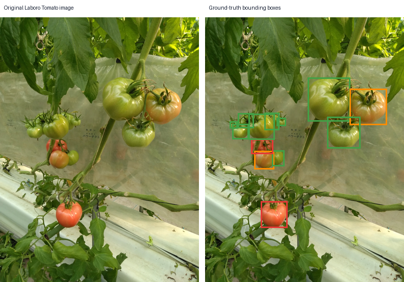

<div align="center">

# TRACE

### **T**omato **R**ecognition **A**nd **C**oding **E**valuation

<a href="https://muhammad0isah.github.io/TRACE/" target="_blank" rel="noopener noreferrer"></a> [](https://github.com/laboroai/LaboroTomato) [](LICENSE) [](.github/workflows/score_submission.yml) [](encryption/)

</div>

## Overview

**TRACE** is an object-detection coding benchmark for comparing human and LLM
solutions on real tomato-farm images.

**Task:** object detection  
**Metric:** F1 score (micro; IoU ≥ 0.50, confidence ≥ 0.50)  
**Data:** full Laboro Tomato `tomato_mixed` release — 643 train / 161 test images, 6 classes  
**Leaderboard:** [live page](https://muhammad0isah.github.io/TRACE/) · [CSV](docs/leaderboard.csv)

---

## Dataset

TRACE retains all official images, all boxes, and the original train/test split.
Images receive reproducible mild RGB Gaussian noise (seed 25, sigma 3/255).
Boxes remain in native image coordinates. Categories are fully ripe, half ripe,
and green tomatoes in large and small size groups.

The original data is [Laboro Tomato](https://github.com/laboroai/LaboroTomato),
licensed CC BY-NC-SA 4.0. This competition uses its bounding-box annotations.

### Annotation example



The left panel is an official training image. The right panel shows the target
bounding boxes used for object-detection training; box colours distinguish the
six tomato size-and-ripeness classes.

---

## Repository Structure

```
TRACE/
├── data/public/                 # training images/boxes and test images
├── encryption/
│   ├── public_key.pem           # use this to encrypt submissions
│   └── encrypt.py
├── competition/                 # validation, scoring and leaderboard code
├── baseline.py                  # GraphSSDLite baseline
├── submissions/
│   └── <team>/                  # your encrypted prediction + metadata
└── leaderboard/
    └── leaderboard.csv          # automatically updated scores
```

---

## How to Participate

### 1. Install

```bash
pip install -r requirements.txt
pip install -r requirements-baseline.txt
```

### 2. Train and predict

Train a GNN method using every image in `data/public/train/`. The supplied
GraphSSDLite baseline writes a valid prediction file:

```bash
python baseline.py --data data/public --output predictions/baseline.json
```

Your JSON must include every test image ID. Each prediction has an image ID,
category ID, native-coordinate `[x, y, width, height]` box, and confidence score.

### 3. Encrypt

```bash
mkdir -p submissions/YOUR_TEAM_NAME
python -m encryption.encrypt predictions/your_gnn_predictions.json submissions/YOUR_TEAM_NAME/submission.enc
```

Create `submissions/YOUR_TEAM_NAME/meta.json`:

```json
{
  "team": "YOUR_TEAM_NAME",
  "model": "My GNN detector",
  "type": "human",
  "notes": "Short description"
}
```

### 4. Open a pull request

```
submissions/<team>/
├── submission.enc
└── meta.json
```

Commit only those two files and open a PR. The workflow decrypts, validates,
scores and publishes your result automatically.

---

## Rules

- One valid submission per team. The `team` field inside `meta.json` must match the folder name.
- Only GNN-based methods are eligible.
- Submit encrypted predictions only.
- CPU only: maximum 4 threads and 3 hours total training/prediction time.
- Train only with the released training data; do not use test labels or external pretrained weights.

---

## Baseline

`baseline.py` uses GraphSSDLite: SSDLite with fixed four-neighbour graph
message-passing layers on all six feature-pyramid maps. It is trained from
scratch on all 643 training images and predicts all 161 test images on CPU.

---

## License

Competition code is MIT. Laboro Tomato images and annotations remain under
CC BY-NC-SA 4.0.

## Citation

```bibtex
@misc{trace_2026,
  title={TRACE: Tomato Recognition And Coding Evaluation},
  author={Muhammad Ibrahim Isah},
  year={2026}
}
```
